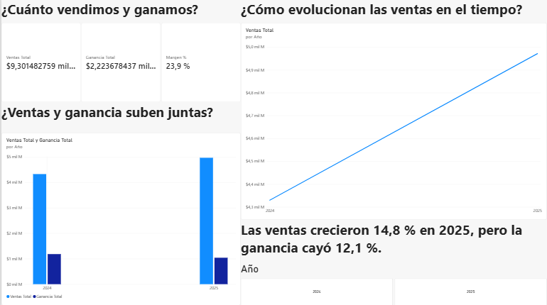
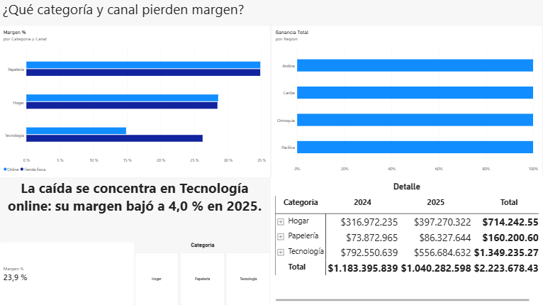
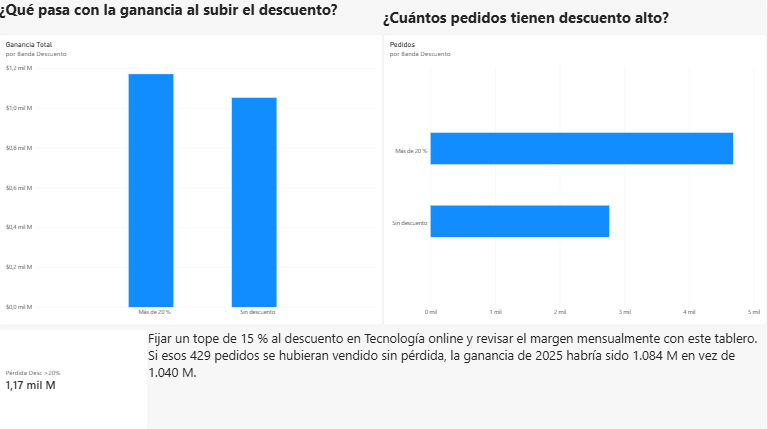

# Corte 3 · Semana 4 — Dashboard interactivo con narrativa

**Estudiante:** Jesús Anibal Zambrano Orjuela
**Programa:** Ingeniería de Sistemas — Facultad de Ingeniería, CORHUILA
**Herramienta:** Power BI Desktop
**Archivo:** `dashboard_corte3.pbix`

---
## Datos

Ventas de una cadena minorista colombiana (dataset sintético, 2024-2025): fecha, región → departamento → ciudad, categoría y subcategoría, canal (tienda física / online), unidades, descuento, ventas, costo y ganancia (valores en COP).

## Narrativa (tres momentos)

| Vista | Pregunta | Título-conclusión | Dato resaltado |
|---|---|---|---|
| **1. Contexto** | ¿Cómo nos fue en 2025? | Las ventas crecieron 14,8 %, pero la ganancia cayó 12,1 % | Margen 2025: **20,9 %** (27,3 % en 2024) |
| **2. Hallazgo** | ¿Dónde se pierde el margen? | La caída se concentra en Tecnología online | Margen Tecnología online 2025: **4,0 %** |
| **3. Recomendación** | ¿Qué hacemos? | Los descuentos mayores al 20 % generan pérdidas | **−43,7 M COP** en 429 pedidos |

## Visuales y buenas prácticas

| Pregunta | Gráfico elegido | Por qué |
|---|---|---|
| Totales del periodo | Tarjetas (KPI) | Un número, sin distracciones |
| Evolución de las ventas | Líneas con jerarquía Año → Trimestre → Mes | Tendencia en el tiempo |
| Ventas vs. ganancia por año | Columnas agrupadas | Comparación de dos medidas |
| Margen por categoría y canal | Barras horizontales ordenadas | Comparación entre categorías con etiquetas legibles |
| Ganancia por geografía | Barras con jerarquía Región → Departamento → Ciudad | Ranking con drill-down |
| Ganancia por banda de descuento | Columnas en orden lógico, negativo en rojo | Muestra el punto donde el descuento destruye ganancia |

Se aplicaron: ejes desde cero, orden por valor, un solo color de énfasis, sin bordes ni 3D, y títulos que enuncian la conclusión.

## Interactividad

- **Segmentadores:** Año y Canal (más Región), sincronizados en las tres páginas.
- **Drill-down:** jerarquía de fecha (Año → Trimestre → Mes) y geográfica (Región → Departamento → Ciudad). Ver `capturas/04_drilldown.png`.
- **Filtrado cruzado:** al seleccionar *Tecnología* en el gráfico de categorías se filtran la matriz y el gráfico geográfico; las interacciones se ajustaron con *Editar interacciones*. Ver `capturas/05_filtrado_cruzado.png`.

---

## Dashboard & insight

This Power BI dashboard analyzes 7,445 retail orders from 2024 and 2025 across four Colombian regions, three product categories and two sales channels. It is organized as a three-page story: context, finding and recommendation, and each page highlights one key figure in a KPI card. Users can filter every page with synchronized slicers for year and channel, drill down through a date hierarchy (year → quarter → month) and a geographic hierarchy (region → department → city), and click any bar to cross-filter the other visuals. The key insight is that sales grew 14.8% in 2025 while profit fell 12.1%, because the profit margin dropped from 27.3% to 20.9%. The drop is concentrated in online Technology sales, whose margin fell to only 4.0%, and orders with discounts above 20% lost COP 43.7 million across 429 orders. Therefore, we recommend capping discounts on online Technology products at 15% and using this dashboard every month to track margin by category and channel before approving new promotions.
