# Proyecto de aula · Corte 3 — Del dato a la decisión

## Tablero de inteligencia de negocios para la producción de leche de Ganadera San Isidro del Huila S.A.S.

**Curso:** Electiva Inteligencia de Negocios 2026-B · Grupo 1
**Docente:** Jesús Ariel González Bonilla
**Programa:** Ingeniería de Sistemas · Facultad de Ingeniería · Corporación Universitaria del Huila (CORHUILA)
**Integrantes:** Jesús Anibal Zambrano Orjuela · Danna Camila Cuevas
**Herramientas:** Power BI Desktop (Power Query, DAX), Python (generación de datos)
**Tablero:** [`GanaderaSanIsidro.pbix`](GanaderaSanIsidro.pbix)

---

## 1. Ficha del proyecto (Fase 0)

| Campo | Respuesta |
|---|---|
| Integrantes (máximo dos) | Jesús Anibal Zambrano Orjuela · Danna Camila Cuevas |
| Empresa y tipo | Ganadera San Isidro del Huila S.A.S. — **ficticia** |
| A qué se dedica | Ganadería bovina de doble propósito con 4 fincas en el Huila: La Esperanza (Palermo), El Cedral (Aipe), Buenavista (Garzón) y Los Naranjos (Pitalito). Tiene 225 vacas de cuatro razas o cruces. Vende la leche cruda a una planta acopiadora regional y las crías se levantan para venta. |
| Problema | La empresa reparte el suplemento alimenticio igual en todas las fincas (unos 2,5 kg/vaca/día en época seca), sin saber en qué fincas y en qué razas cae más la leche cuando llega la sequía. Los registros de ordeño existen, pero están en un archivo exportado con errores y nadie los consolida. |
| Pregunta de negocio | **¿Qué fincas y qué razas explican la caída de litros por vaca al día en la época seca de julio a septiembre de 2026 y cuánto ingreso dejó de recibir la empresa?** |
| KPI principal y fórmula | **Litros por vaca al día** = Σ litros pesados ÷ número de controles (una vaca en ordeño pesada en un día de control). Meta: 7,5 L. |
| KPI de apoyo | 1) **Ingreso dejado de percibir** = Σ por finca y raza de [(L/vaca/día en lluvias mar-may − L/vaca/día en seca) × controles × 7] × precio promedio del litro. 2) **Costo de suplemento por litro** = Σ costo del suplemento ÷ Σ litros. |
| Fuentes de datos y formato | `control_lechero.csv` (exportación del software de ordeño, separador `;`), `maestros_ganadera.xlsx` (hojas Fincas, Animales y Potreros) y `precios_leche.csv` (liquidación mensual de la planta acopiadora). |
| Autorización | No aplica: empresa ficticia con datos sintéticos. |

## 2. Contexto

En 2025 Colombia produjo 8.405 millones de litros de leche, la cifra más alta en dos décadas (Fedegán–USP). Pero en la región de doble propósito el acopio formal cayó 5,6 % entre enero y septiembre de 2025. El Huila tiene cerca de 460.000 bovinos en 17.000 predios, con vocación de doble propósito. En la sequía de 2023 el Comité de Ganaderos estimó que se dejaron de producir cerca de 118.000 litros de leche por falta de pastos. La época seca es el momento en que una finca de doble propósito gana o pierde el año, y ahí es donde los datos ayudan a decidir.

## 3. Datos (empresa ficticia)

### 3.1 Cómo se generaron
Los datos se generaron con Python (`scripts/generar_datos_ganaderia.py`, semilla fija 1309, reproducible) con estas reglas de realismo:

- **Curva de lactancia de Wood:** y(t) = a·t^0,2·e^(−0,004·t), con pico cerca del día 50 posparto.
- **Producción pico por raza:** Gyr 8 L, Girolando 10 L, F1 Holstein x Cebú 11,5 L, Simmental x Cebú 9 L. La primera lactancia produce 15 % menos y cada vaca varía ±12 %.
- **Ciclo productivo:** un parto cada ~430 días, lactancia de 270 a 300 días y control lechero semanal; cada finca pesa un día fijo de la semana.
- **Clima del Huila:** dos épocas secas, dic-feb (moderada) y jul-sep (fuerte). La seca de jul-sep 2026 fue más intensa que la de 2025.
- **Efecto de la sequía:** depende de la finca (las de tierra baja y sin riego, Aipe y Palermo, sufren más) y de la raza (el cruce Holstein tolera peor el calor y el Gyr lo tolera mejor).
- **Suplemento:** uniforme en todas las fincas, de 1,5 a 2,5 kg/vaca/día y +0,5 kg en seca. Precio del kilo: $1.750 en 2025 y $1.900 en 2026.
- **Precio de la leche:** de $1.837 a ~$2.080 por litro, un poco más alto en los meses secos.

**Mínimos de la guía:** 15.400 filas de hechos después del ETL (≥ 1.000), tres dimensiones más la tabla calendario (≥ 3) y 24 meses de historia (nov-2024 a oct-2026, ≥ 12).

### 3.2 Problemas de calidad introducidos a propósito

| # | Problema | Dónde | Magnitud |
|---|---|---|---|
| P1 | Filas duplicadas (doble exportación) | control_lechero.csv | 309 filas |
| P2 | Fechas en dos formatos (`dd/mm/aaaa` y `aaaa-mm-dd`) | control_lechero.csv | ~35 % de las filas |
| P3 | Litros con coma decimal, errores de digitación x10 (85 en vez de 8,5) y vacíos | control_lechero.csv | ~25 % con coma, 101 x10, 60 vacíos |
| P4 | Texto inconsistente: raza en 13 variantes («GYR», «Gir», «f1 holstein x cebú»…) y nombre de finca con mayúsculas y espacios | maestros_ganadera.xlsx / control_lechero.csv | 13 variantes → 4 razas |

## 4. ETL con Power Query (Fase 1)

El código M completo está en [`GUIA_POWERBI.md`](GUIA_POWERBI.md). Pasos aplicados a la tabla de hechos `FactControl`:

| Paso aplicado | Qué hace | Motivo |
|---|---|---|
| `Encabezados` | Promueve la primera fila a encabezados | El CSV trae los nombres de columna en la fila 1 |
| `QuitarDuplicados` | Quita filas idénticas | **P1**: el software exportó 309 controles dos veces y eso inflaba los litros |
| `QuitarFincaTexto` | Elimina la columna `Finca` (texto) | **P4**: viene escrita de varias formas; se usa el código `IdFinca`, que es confiable |
| `FechaUnificada` | Convierte cada fecha según su formato | **P2**: con un solo cambio de tipo, las fechas `aaaa-mm-dd` se leían como día/mes invertidos |
| `ComaAPunto` + `Tipos` (en-US) | Reemplaza `,` por `.` y convierte a número | **P3**: «8,5» quedaba como texto o como 85 |
| `QuitarLitrosVacios` | Elimina los controles sin litros | **P3**: 60 controles sin dato no pueden entrar al promedio |
| `CorregirX10` | Si litros > 30, divide entre 10 (la columna se vuelve a declarar como número) | **P3**: ninguna vaca de doble propósito da 30 L/día; son 101 errores de digitación |
| `AnioMes` + `CombinarPrecios` | Combina con la tabla de precios del mes | Calcular el ingreso con el precio real de cada mes |
| `IngresoSemanal` | Litros × 7 × precio | Cada control representa una semana de ordeño |

En `DimAnimal`: `RecortarMinus` (quita espacios y pasa a minúsculas) → `TildeCebu` → `RazaEstandar`. Con esto las 13 variantes de la raza quedan en 4 valores (**P4**).

**Antes y después** (capturas en `capturas/`):

| Control | Antes | Después |
|---|---|---|
| Filas de hechos | 15.769 | 15.400 |
| Tipo de `Fecha` | Texto, 2 formatos | Fecha (01/11/2024 – 30/10/2026) |
| `LitrosDia` | Texto con comas, máx. 139, 62 vacíos | Número, de 2,8 a 16,1 L, 0 vacíos |
| Valores distintos de `Raza` | 13 | 4 |

| Antes | Después |
|---|---|
| 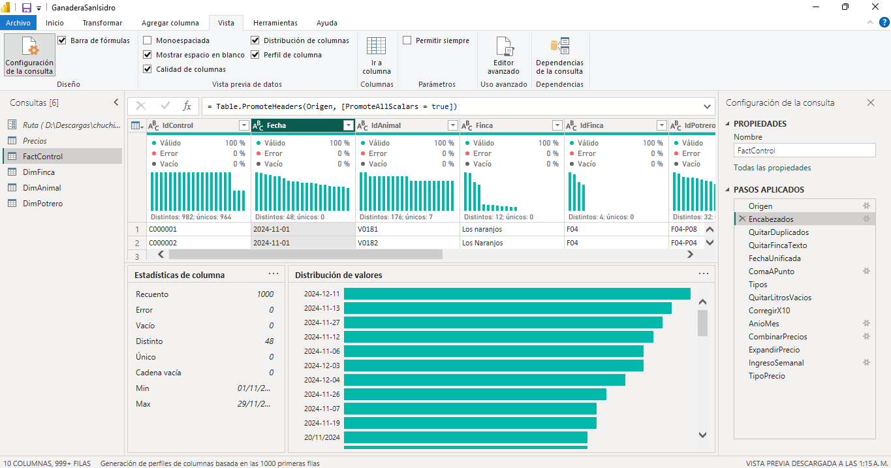 | 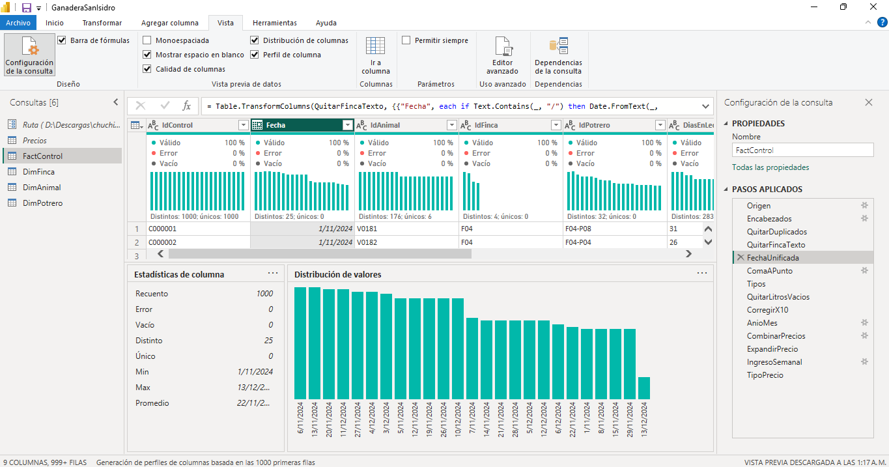 |
| 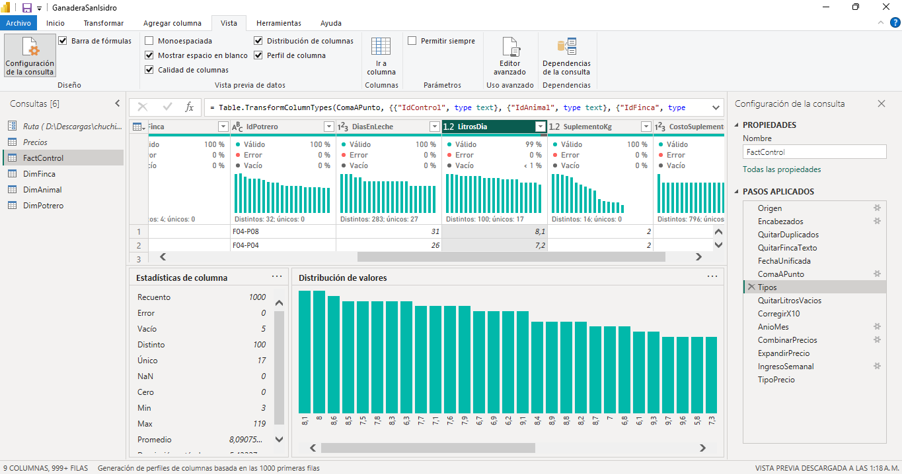 |  |
| 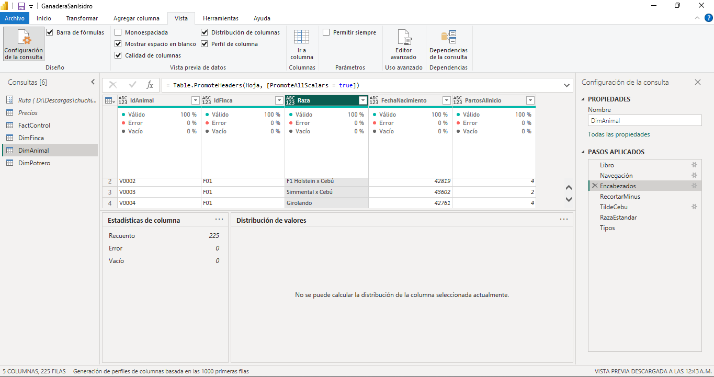 | 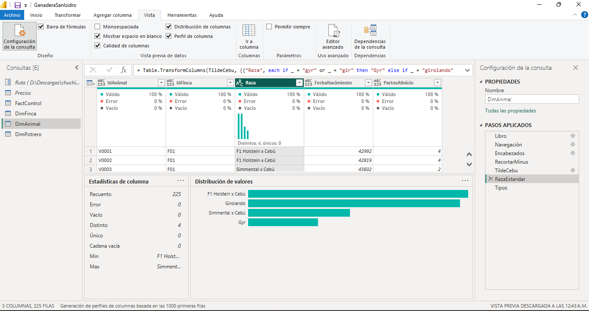 |
| 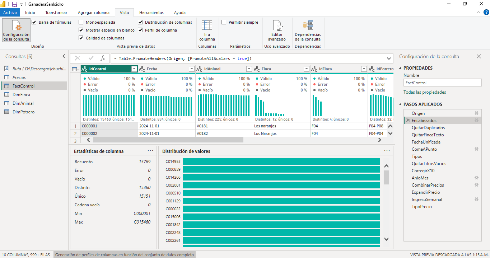 | 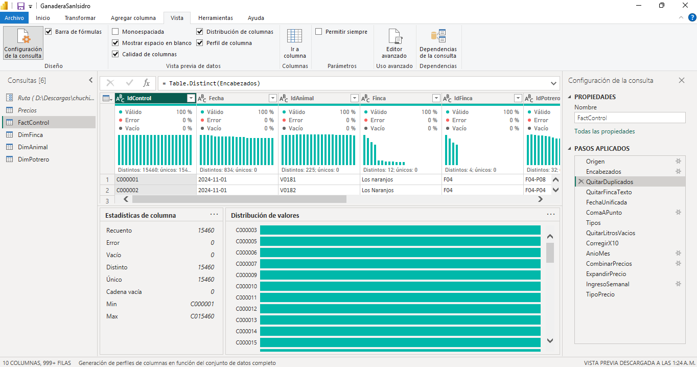 |

## 5. Diccionario de datos

**Grano de `FactControl`:** una fila = el pesaje de leche de **una vaca en ordeño en un día de control** (control lechero semanal por finca).

| Tabla | Columna | Tipo | Descripción | Ejemplo |
|---|---|---|---|---|
| FactControl | IdControl | Texto | Código único del control | C000001 |
| FactControl | Fecha | Fecha | Día del pesaje | 01/11/2024 |
| FactControl | IdAnimal | Texto | Código de la vaca (FK) | V0181 |
| FactControl | IdFinca | Texto | Finca donde se ordeñó (FK) | F04 |
| FactControl | IdPotrero | Texto | Potrero en el que pastaba (FK) | F04-P08 |
| FactControl | DiasEnLeche | Entero | Días desde el último parto | 31 |
| FactControl | LitrosDia | Decimal | Litros producidos ese día (AM + PM) | 8,1 |
| FactControl | SuplementoKg | Decimal | Kg de suplemento suministrados ese día | 2,0 |
| FactControl | CostoSuplemento | Entero | Costo del suplemento del día (COP) | 3.420 |
| FactControl | AnioMes | Texto | Año-mes para combinar con precios | 2024-11 |
| FactControl | PrecioLitro | Decimal | Precio pagado por la planta ese mes (COP/L) | 1.837 |
| FactControl | IngresoSemanal | Decimal | LitrosDia × 7 × PrecioLitro (COP) | 104.157,9 |
| DimFinca | IdFinca | Texto | Código de la finca (PK) | F02 |
| DimFinca | Finca | Texto | Nombre de la finca | El Cedral |
| DimFinca | Municipio | Texto | Municipio del Huila | Aipe |
| DimFinca | Subregion | Texto | Subregión del Huila | Norte |
| DimFinca | AltitudMsnm | Entero | Altitud en metros sobre el nivel del mar | 380 |
| DimFinca | Hectareas | Entero | Área de la finca | 210 |
| DimFinca | Riego | Texto | ¿Tiene riego de praderas? | No |
| DimAnimal | IdAnimal | Texto | Código de la vaca (PK) | V0001 |
| DimAnimal | IdFinca | Texto | Finca de asignación (informativo) | F01 |
| DimAnimal | Raza | Texto | Raza o cruce estandarizado | F1 Holstein x Cebú |
| DimAnimal | FechaNacimiento | Fecha | Fecha de nacimiento | 14/09/2017 |
| DimAnimal | PartosAlInicio | Entero | Partos al 1/11/2024 | 4 |
| DimPotrero | IdPotrero | Texto | Código del potrero (PK) | F01-P02 |
| DimPotrero | IdFinca | Texto | Finca del potrero (informativo) | F01 |
| DimPotrero | Potrero | Texto | Nombre del potrero | Potrero 2 |
| DimPotrero | Pasto | Texto | Especie forrajera | Angleton |
| DimPotrero | Hectareas | Decimal | Área del potrero | 22,4 |
| Calendario | Date | Fecha | Día (PK) | 15/08/2026 |
| Calendario | Año / MesNum / Mes / AñoMes | Entero / Texto | Partes de la fecha | 2026 / 8 / ago / 2026-08 |
| Calendario | Época | Texto | Seca o Lluvias | Seca |
| Calendario | Temporada | Texto | Seca jul-sep, Seca dic-feb, Lluvias mar-may, Lluvias jun, oct, nov | Seca jul-sep |

## 6. Modelo estrella (Fase 2)

```
                 Calendario
                     │ 1
                     │
 DimFinca 1 ─── * FactControl * ─── 1 DimAnimal
                     │ *
                     │
                 1 DimPotrero
```
- Una tabla de hechos, tres dimensiones y una tabla calendario, con relaciones de uno a varios en una sola dirección.
- Jerarquía **Ubicación**: Subregión → Municipio → Finca, más Potrero en el gráfico de drill-down.

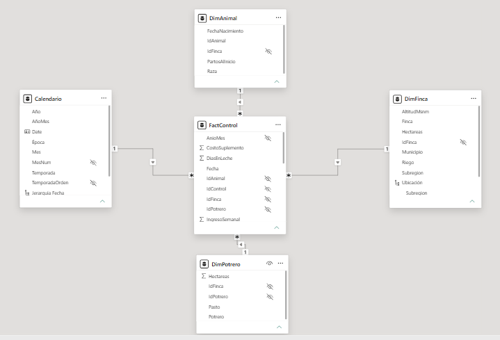

## 7. Medidas DAX y cifras de control


| Medida | Fórmula (resumen) | Sin filtros | 2026 · Seca jul-sep |
|---|---|---|---|
| Controles | `COUNTROWS(FactControl)` | 15.400 | 1.863 |
| Vacas en ordeño | `DISTINCTCOUNT(IdAnimal)` | 225 | — |
| Litros | `SUM(LitrosDia)` | 117.359,4 | — |
| **Litros por vaca/día (KPI)** | `DIVIDE([Litros],[Controles])` | **7,62** | **6,47** |
| Costo suplemento por litro | `DIVIDE(SUM(CostoSuplemento),[Litros])` | $535 | — |
| % controles bajo 6 L | controles con < 6 L ÷ controles | 22,1 % | — |
| Ingreso estimado | `SUM(IngresoSemanal)` | $1.633.496.447 | — |
| L/vaca/día lluvias 2026 | KPI con año 2026 y temporada lluvias mar-may | 8,20 | 8,20 |
| Variación vs lluvias % | (KPI − referencia) ÷ referencia | — | **−21,1 %** |
| Litros perdidos | `SUMX` por finca × raza de la caída × controles × 7 | — | **23.919,7 L** |
| Ingreso perdido | Litros perdidos × precio promedio | — | **$50.428.775** |

## 8. Tablero e interactividad

Tres páginas, una pregunta por página. El KPI va arriba a la izquierda. Hay tres segmentadores sincronizados (Año, Temporada y Raza), drill-down en Calendario (Año → Mes) y en Ubicación (Subregión → Municipio → Finca → Potrero), y las interacciones se revisaron una por una con *Editar interacciones*.

| Página | Pregunta | Título-conclusión |
|---|---|---|
| 1. Contexto | ¿Cómo va la producción de leche? | En la seca de jul-sep 2026 la producción cayó a 6,47 L/vaca/día, la más baja de los dos años |
| 2. Hallazgo | ¿En qué fincas y razas cae la leche en la sequía? | El Cedral (Aipe) pierde el 35 % de su leche en la seca; el F1 Holstein x Cebú es la raza más afectada |
| 3. Recomendación | ¿Cuánto cuesta la sequía y qué hacer? | Las fincas del norte concentran el 77 % de la leche perdida, pero reciben el mismo suplemento que las demás |

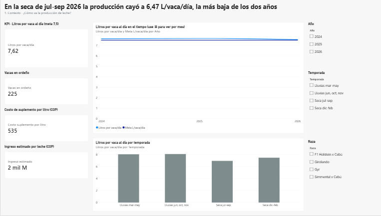
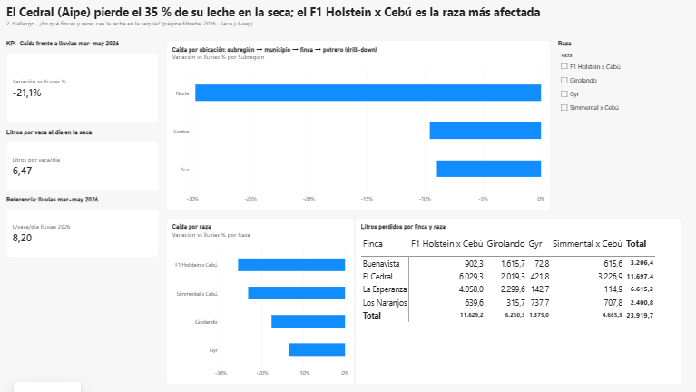
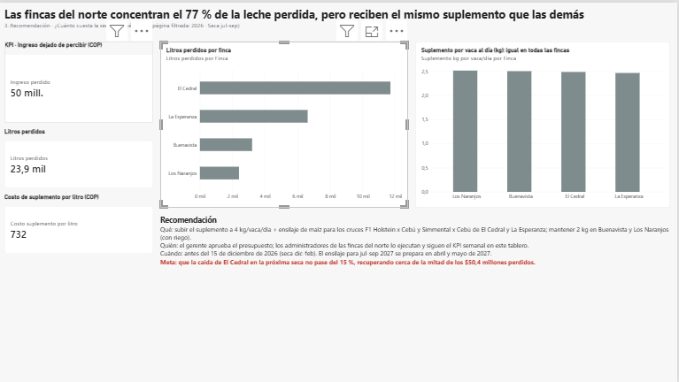
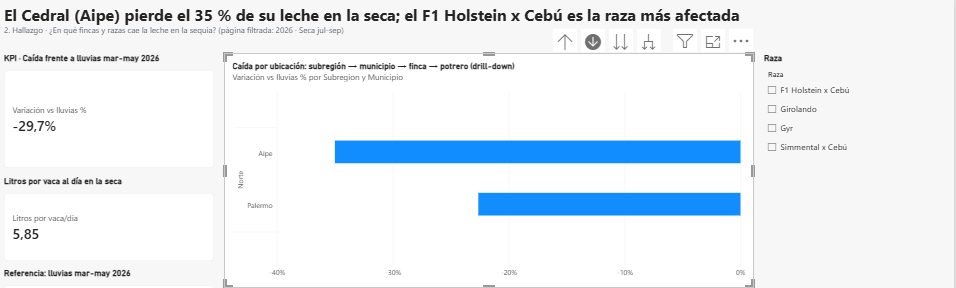

### Prueba del clic

| # | Selección | Cifra de control | Cifra en el tablero | ¿Coincide? |
|---|---|---|---|---|
| 1 | Página 1, segmentador Raza = **F1 Holstein x Cebú** | 8,43 L/vaca/día · 5.564 controles | 8,43 | ✅ |
| 2 | Página 1, segmentador Temporada = **Seca jul-sep** (ambos años) | 6,93 L/vaca/día · 3.645 controles | 6,93 | ✅ |
| 3 | Página 2 (2026 · Seca jul-sep) + Raza F1 Holstein x Cebú + clic en **El Cedral** en la matriz | 5,49 L/vaca/día · 243 controles | 5,49 | ✅ |

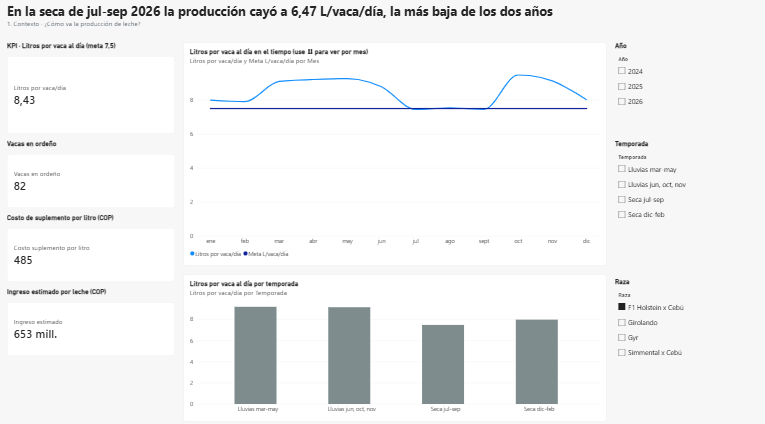
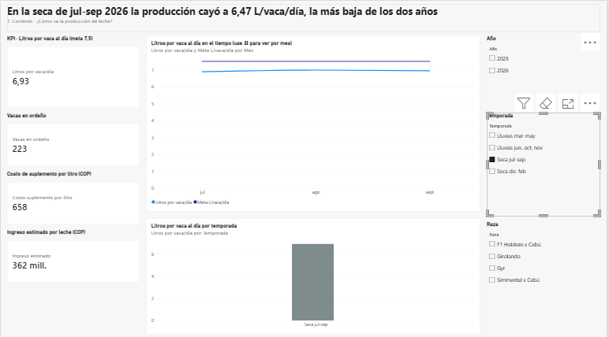
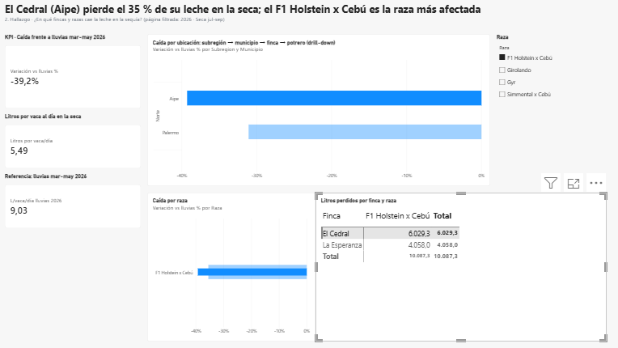

## 9. Historia del tablero

**Contexto.** Entre noviembre de 2024 y octubre de 2026, las 225 vacas de la empresa promediaron **7,62 L/vaca/día**, por encima de la meta de 7,5 L. Pero en la época seca de julio a septiembre de 2026 el promedio bajó a **6,47 L**: un 21,1 % menos que en las lluvias de marzo a mayo de 2026 (8,20 L) y un 12,7 % menos que en la misma época de 2025 (7,41 L).

**Hallazgo.** La caída no fue pareja:

| Finca | Lluvias mar-may 2026 | Seca jul-sep 2026 | Caída |
|---|---|---|---|
| El Cedral (Aipe, sin riego, 380 msnm) | 8,34 L | 5,42 L | −35,0 % |
| La Esperanza (Palermo, sin riego) | 8,31 L | 6,43 L | −22,6 % |
| Buenavista (Garzón, con riego) | 7,89 L | 7,13 L | −9,6 % |
| Los Naranjos (Pitalito, con riego) | 8,16 L | 7,43 L | −9,0 % |

Por raza, el **F1 Holstein x Cebú** cayó 25,8 % y el **Gyr** solo 13,6 %. En total se dejaron de producir **23.920 litros**, que equivalen a **$50,4 millones**. De esa pérdida, las dos fincas del norte (El Cedral y La Esperanza) concentran el **76,6 %** y el F1 Holstein x Cebú el **48,6 %**. Sin embargo, las cuatro fincas recibieron el mismo suplemento (~2,5 kg/vaca/día). Por eso en El Cedral cada litro costó $872 de suplemento, frente a $644 en Los Naranjos.

**Recomendación accionable.**
1. **Qué:** redistribuir el suplemento en la época seca. Subir a 4 kg/vaca/día, más ensilaje de maíz, para las vacas F1 Holstein x Cebú y Simmental x Cebú de El Cedral y La Esperanza. Mantener 2 kg en Buenavista y Los Naranjos, que tienen riego y casi no pierden leche.
2. **Quién:** el gerente aprueba el presupuesto de suplemento y ensilaje; los administradores de El Cedral y La Esperanza lo ejecutan y siguen el KPI semanal en este tablero.
3. **Cuándo:** antes del 15 de diciembre de 2026, para la seca de diciembre a febrero; el ensilaje para la seca de julio a septiembre de 2027 se prepara en abril y mayo de 2027.
4. **A mediano plazo:** reponer las vacas de las fincas del norte con Gyr o Girolando, que toleran mejor el calor.
5. **Cómo se mide:** la meta es que la caída de El Cedral en la próxima seca no pase del 15 %. Eso recuperaría cerca de la mitad de los $50,4 millones perdidos.

## 10. Estructura de la carpeta

```
15-week/proyecto-aula/
├── README.md
├── GanaderaSanIsidro.pbix           # tablero de Power BI
├── datos/
│   ├── control_lechero.csv         # hechos crudos (con errores a propósito)
│   ├── maestros_ganadera.xlsx      # Fincas, Animales, Potreros
│   └── precios_leche.csv
├── scripts/
│   ├── generar_datos_ganaderia.py  # generación reproducible de los datos
│   └── etl_y_cifras_control.py     # mismas reglas del ETL para validar cifras
└── capturas/                       # 16 capturas: ETL antes/después, modelo, páginas, drill-down, prueba del clic
```

> El FO-IV-159 contiene datos de identificación y **no** se publica en este repositorio; se entrega solo por Moodle.

---

## Overview & insights

San Isidro del Huila Cattle Company is a fictional dual-purpose cattle business with four farms in Huila, Colombia. It distributes the same amount of feed supplement to every farm during the dry season without knowing which farms and breeds lose the most milk. We generated 15,769 weekly milk-recording rows for 225 cows between November 2024 and October 2026. In Power Query we removed 309 duplicate rows, unified two date formats, fixed decimal commas and 101 typing errors, dropped 60 empty records and standardized 13 spellings of the breed into 4 values. The data was organized as a star schema with one fact table (one row per cow per recording day), three dimensions (farm, animal and paddock) and a calendar table. The main KPI, liters per cow per day, averaged 7.62 L, but in the July–September 2026 dry season it fell to 6.47 L, which is 21.1% below the March–May rainy season. The key insight is that the two northern farms without irrigation, El Cedral and La Esperanza, account for 76.6% of the 23,920 liters lost (about COP 50.4 million), and the Holstein × Zebu crossbred cows explain 48.6% of that loss. We therefore recommend that before December 15, 2026, management raise supplementation to 4 kg per cow per day plus corn silage for crossbred cows on the northern farms, keep the current amount on the irrigated farms, and track the weekly KPI in this dashboard.

## Referencias principales
- Kimball, R., & Ross, M. (2013). *The data warehouse toolkit: The definitive guide to dimensional modeling* (3.ª ed.). John Wiley & Sons.
- Microsoft. (s. f.). *Documentación de Power BI*. https://learn.microsoft.com/es-es/power-bi/
- Microsoft. (s. f.). *Referencia de Power Query M* y *Referencia de DAX*. https://learn.microsoft.com/es-es/powerquery-m/ · https://learn.microsoft.com/es-es/dax/
- CONtexto ganadero. (2023, 15 de septiembre). *Más de 450 mil cabezas de ganado en el Huila aguantan las sequías*.
- CONtexto ganadero. (2026). *Producción de leche rompe récord en Colombia: 8.405 millones de litros en 2025*.
